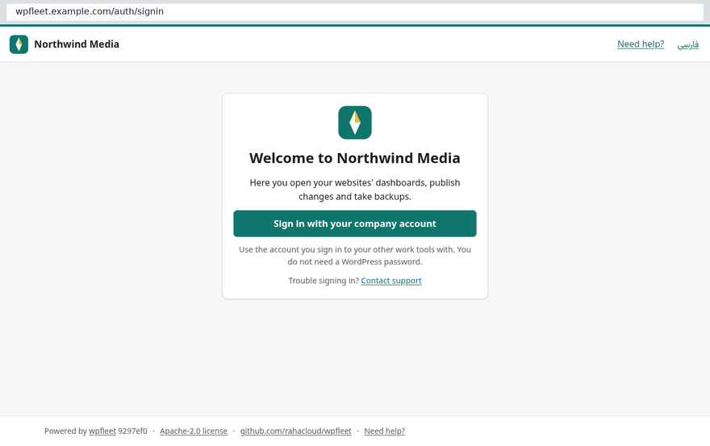
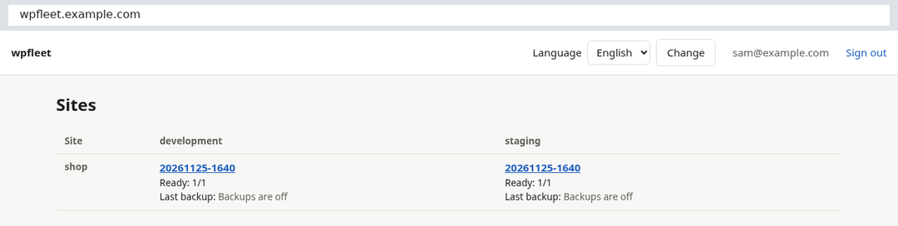
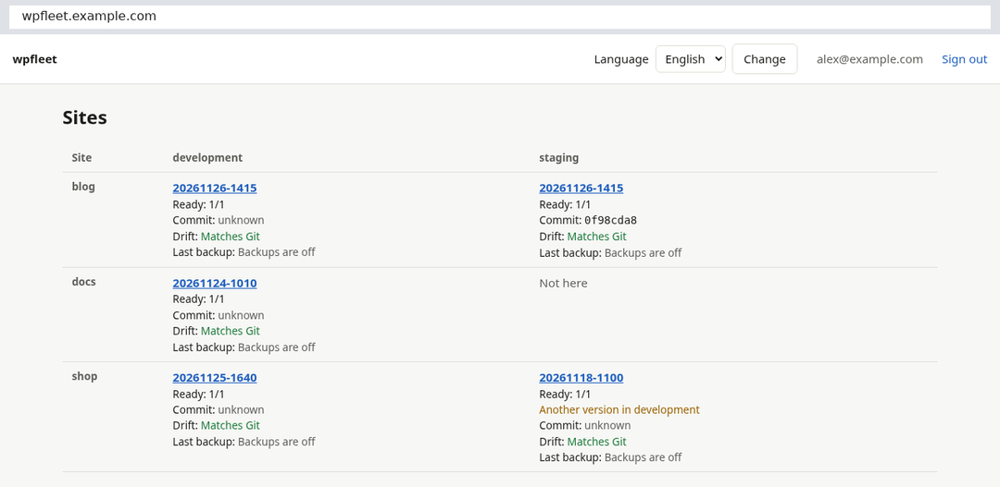

# wpfleet

Manage a fleet of WordPress sites on Kubernetes from one Git repository: deploy every site with one shared Helm chart, build and promote site images from development to production, open a site's admin with a one-time link, and back sites up to S3 and restore them.

> **Status: before its first release.** Every command in [docs/design.md](docs/design.md) is built and covered by tests against fakes. `sites list`, `deploy`, `diff`, `promote` and `admin` have run against a real cluster (a local kind cluster, 2026-11-27); `build`, `backup` and `copy` have not yet run against a real registry or bucket. `serve` has run in the same kind cluster from its chart, with Dex for sign-in and Gitea as the fleet repository, and was driven in headless Chromium (2026-11-27); backups through it have not run, since that cluster has no bucket. Expect rough edges until v0.1. `docs/design.md` is the contract the commands are built against.

## How it works

A fleet is a Git repository with a `wpfleet.yaml` and one values directory per environment. Each site is one Helm release of the embedded [WordPress chart](charts/wordpress), rendered from the environment's `_shared.yaml` and the site's own file. The site's code (core, themes and plugins) is an immutable image; its uploads live on a volume and its data in MariaDB.

```bash
wpfleet sites list                          # every site, its host, image and readiness
wpfleet build blog --source ./blog -e development --set
wpfleet diff blog -e development           # what a deploy would change
wpfleet deploy blog -e development
wpfleet promote blog --to staging && wpfleet deploy blog -e staging
wpfleet admin blog -e staging --open         # one-time login link, valid 60 seconds
wpfleet backup run blog -e production
wpfleet backup restore blog -e staging --stamp latest --uploads
wpfleet copy blog --from production --to staging
```


## Open a site's admin without its password

`wpfleet admin` stores a one-time token in the site through wp-cli and prints a link to it. A must-use plugin that the chart mounts answers the link once, within 60 seconds, and logs in as the site's first administrator, or as `--user`. No password is shared or reset, and the site stores only the hash of the token.


The notice at the top is expected: the chart turns off plugin, theme and core updates in the dashboard, because a site's code is its image, and a new version arrives through `wpfleet build` and `promote` instead.

The pictures come from a demo fleet of three invented sites on a local kind cluster. The browser frames are screenshots from headless Chromium, with the address bar drawn on them afterwards.

## Run the server

`wpfleet serve` runs the same operations behind a web UI with single sign-on, for people who have no kubeconfig: an editor signs in with the company account, sees only the sites the access rules give their groups, and opens a site's admin, publishes staging to live or takes a backup with one click. It runs inside the cluster it manages, from the chart in [deployments/helm/wpfleet](deployments/helm/wpfleet), and works on a clone of the fleet repository: a promotion in the UI is a commit pushed with the person as its author, and every action writes an audit line.

```bash
wpfleet serve --config wpfleet-server.yaml --data /var/lib/wpfleet
```

The configuration file holds the `server` section of [docs/design.md](docs/design.md): the public URL, the fleet repository, the OIDC provider and the access rules. The server refuses to start without the OIDC settings, the session key and at least one access rule. Secrets come only from the environment: `WPFLEET_SESSION_KEY` (32 random bytes in base64, `openssl rand -base64 32`), `WPFLEET_OIDC_CLIENT_SECRET`, `WPFLEET_GIT_SSH_KEY` or `WPFLEET_GIT_TOKEN`, `WPFLEET_GIT_WEBHOOK_SECRET` for push webhooks, and the S3 keys for backups.

## The web UI for the people who run the sites

Editors and marketing teams do not need a terminal. They open the wpfleet address, sign in with the company account, and see only the sites their team looks after. "Open admin" takes them straight into the WordPress dashboard, without a WordPress password; the link is made for that one click and works once.



What a person sees depends on their team. An editor of the shop sees the shop and nothing else, and only the buttons their team may use; for this editor that is "Open admin":



The platform team sees every site in every environment, which version each one runs, whether a newer one waits in the previous environment, and which Git commit is deployed. On a site's page they can publish the previous environment's version, deploy, and take a backup. The UI is also in Persian, right to left.



The UI carries the client's own name, logo and color, set in `server.branding`; the logo and the favicon are files in the client's own fleet repository, so a new logo is a commit. The footer of every page always names wpfleet, its license and this repository.

Every action, allowed or refused, is written to the server's log with the person's email address, and a publication is a Git commit with that person as its author. The pictures come from the demo fleet on a local kind cluster, with invented users signed in through Dex (`sam@example.com` in the shop team, `alex@example.com` in the platform team) and an address bar drawn on them afterwards.

## Development

```bash
just build    # ./wpfleet
just generate # the templ components of the web UI
just test
just lint     # golangci-lint and helm lint
just image    # the server image, wpfleet:dev
```

## License

Apache-2.0, see [LICENSE](LICENSE).
