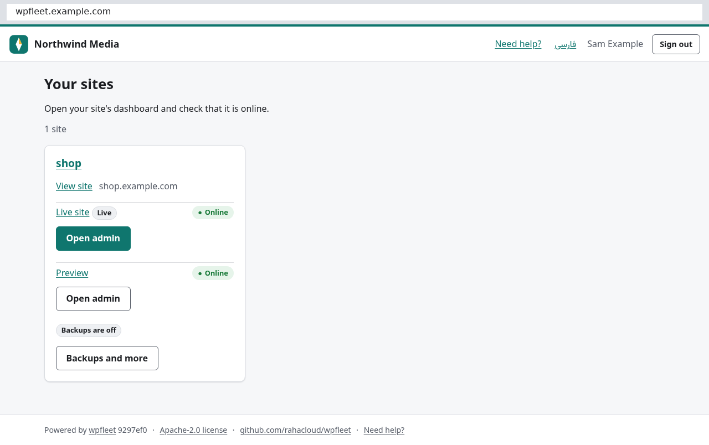
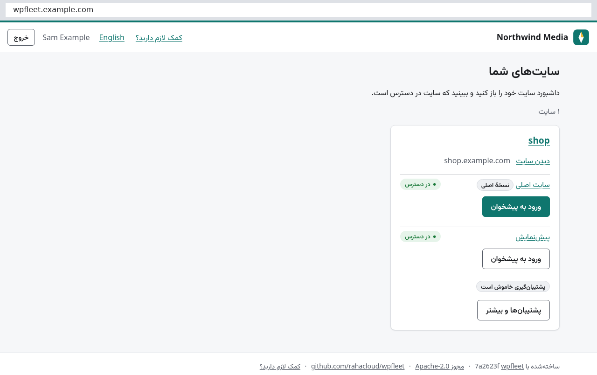
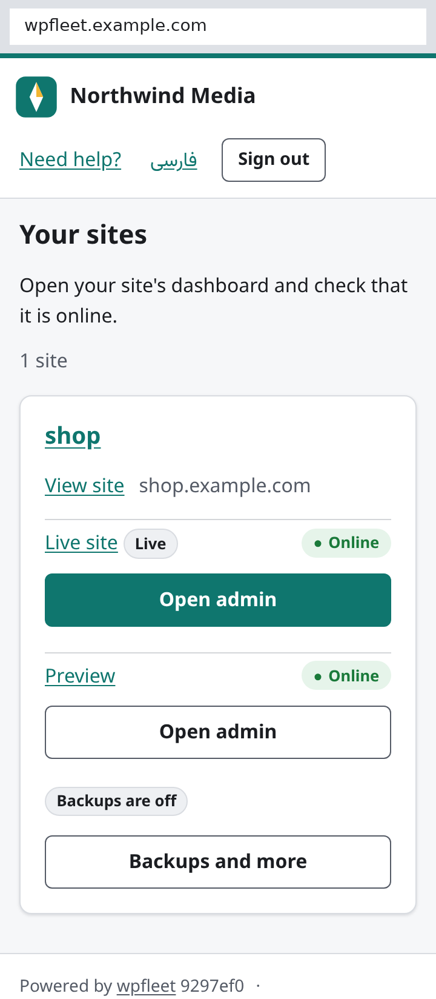

<h1></h1>

<p align="center">
  <a href="https://github.com/rahacloud/wpfleet/actions/workflows/ci.yml"></a>
  <a href="https://pkg.go.dev/github.com/rahacloud/wpfleet"></a>
  <a href="https://goreportcard.com/report/github.com/rahacloud/wpfleet"></a>
  <a href="https://scorecard.dev/viewer/?uri=github.com/rahacloud/wpfleet"></a>
  <a href="LICENSE"></a>
</p>

wpfleet runs many WordPress sites on Kubernetes from one Git repository. Every site is a release of one shared Helm chart, its code is an immutable image, and every change goes through Git, so you always know what runs where and who changed it.

> [!NOTE]
> wpfleet is new and has no release yet. It works end to end on a test cluster, and its first runs on a real fleet are under way. Expect rough edges.

## What it does

- **One chart for every site.** A site is a small values file. `wpfleet diff` shows what a deploy would change before it changes anything.
- **Promote, do not edit live.** Plugins, themes and core ship in the site's image. You build it once and promote the same image from development to staging to production.
- **Admin without a password.** `wpfleet admin` gives a one-time link into a site's dashboard. Nobody shares or resets a password.
- **Backups to S3.** Nightly backups of the database and the uploads, a restore with one command, and a copy of a site from one environment to another.
- **A web UI for content teams.** Editors sign in with the company account, see only their own sites, open the admin, and publish or restore with one click. Every action is in an audit log.

## A quick look

```bash
wpfleet sites list                        # every site, its address, image and status
wpfleet diff blog -e development           # what a deploy would change
wpfleet deploy blog -e development
wpfleet promote blog --to staging && wpfleet deploy blog -e staging
wpfleet admin blog -e staging --open      # one-time login link
wpfleet backup run blog -e production
wpfleet copy blog --from production --to staging
```


`wpfleet admin` opens the dashboard with a link that works once, for 60 seconds:


## The web UI

`wpfleet serve` runs inside your cluster, behind single sign-on with any OIDC provider. Each person sees only the sites that their team looks after, in plain words, with no image tags or commits. Engineers also see the technical details. A publish from the UI is a Git commit with the person as its author.




The UI carries your organization's name, logo and colour. It is in English and Persian, and it works on a phone.

<p>
  
  
</p>

The screenshots come from a demo with invented sites, users and brand.

## Install

```bash
go install github.com/rahacloud/wpfleet/cmd/wpfleet@latest
```

Releases will also have signed binaries for Linux, macOS and Windows, a server image at `ghcr.io/rahacloud/wpfleet`, and the charts at `oci://ghcr.io/rahacloud/charts`. Then continue with [Getting started](docs/getting-started.md).

## Documentation

- [Getting started](docs/getting-started.md): make a fleet repository, deploy a first site, open its admin and back it up.
- [Configuration](docs/configuration.md): every key of `wpfleet.yaml` and of the server.
- [The WordPress chart](docs/chart.md): every value of the chart.
- [For content teams](docs/for-content-teams.md): the web UI in plain words, for editors.
- [Example fleet](examples/fleet): a small fleet with two environments and one site.
- [Design](docs/design.md): how wpfleet works inside.
- [Roadmap](docs/ROADMAP.md): what comes next.

## Contributing

Contributions are welcome. Read [CONTRIBUTING.md](CONTRIBUTING.md) and the [code of conduct](CODE_OF_CONDUCT.md), and report a vulnerability privately as [SECURITY.md](SECURITY.md) says.

wpfleet is made by [RahaCloud](https://rahacloud.com) and is licensed under [Apache-2.0](LICENSE).
