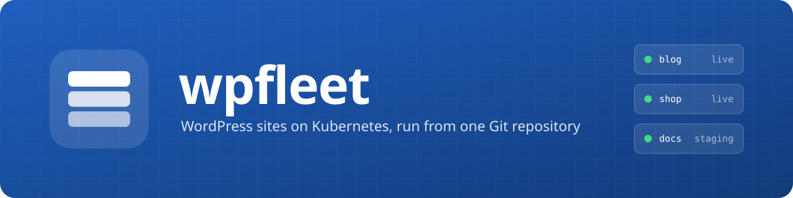
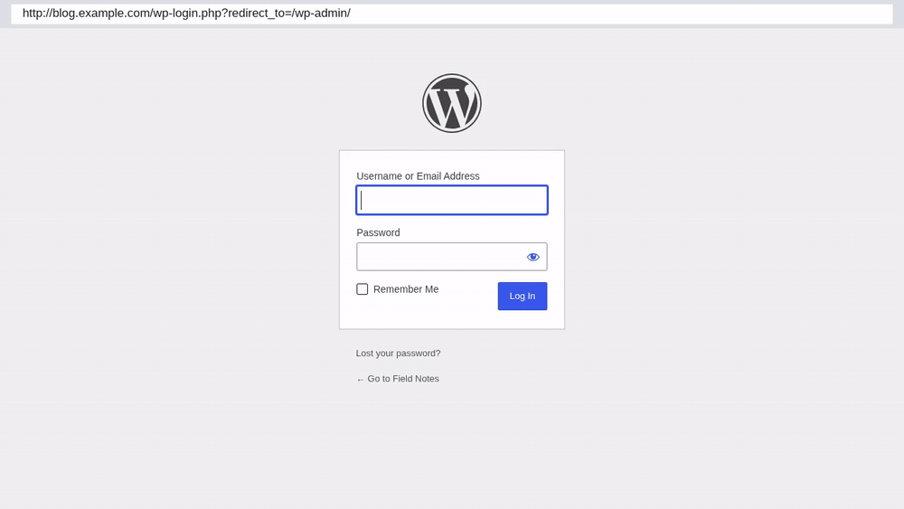
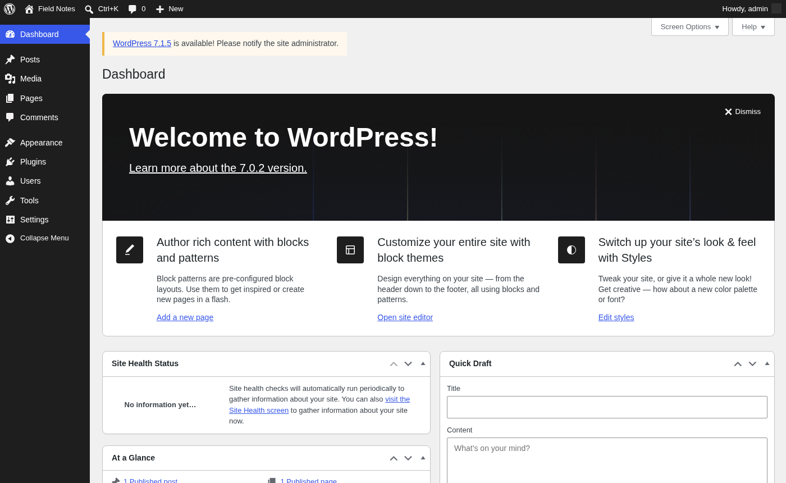
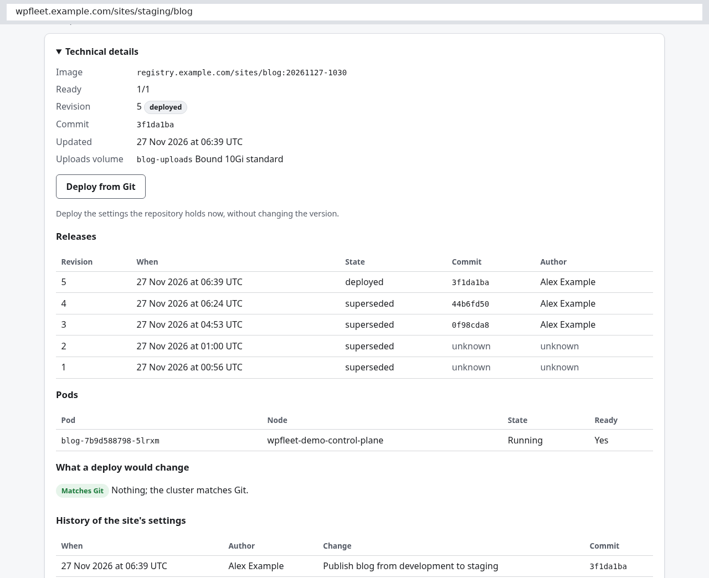

<h1></h1>

Manage a fleet of WordPress sites on Kubernetes from one Git repository: deploy every site with one shared Helm chart, build and promote site images from development to production, open a site's admin with a one-time link, and back sites up to S3 and restore them.

> **Status: before its first release.** Every command in [docs/design.md](docs/design.md) is built and covered by tests against fakes. `sites list`, `deploy`, `diff`, `promote` and `admin` have run against a real cluster (a local kind cluster, 2026-11-27); `build`, `backup` and `copy` have not yet run against a real registry or bucket. `serve` has run in the same kind cluster from its chart, with Dex for sign-in, Gitea as the fleet repository and an invented brand, and was driven in headless Chromium (2026-11-27); backups through it have not run, since that cluster has no bucket. Expect rough edges until v0.1. `docs/design.md` is the contract the commands are built against.

## How it works

A fleet is a Git repository with a `wpfleet.yaml` and one values directory per environment. Each site is one Helm release of the embedded [WordPress chart](charts/wordpress), rendered from the environment's `_shared.yaml` and the site's own file. The site's code (core, themes and plugins) is an immutable image; its uploads live on a volume and its data in MariaDB.

```bash
wpfleet sites list                          # every site, its host, image and readiness
wpfleet build blog --source ./blog -e development --set
wpfleet diff blog -e development           # what a deploy would change
wpfleet deploy blog -e development
wpfleet promote blog --to staging && wpfleet deploy blog -e staging
wpfleet admin blog -e staging --open         # one-time login link, valid 60 seconds
wpfleet backup run blog -e production
wpfleet backup restore blog -e staging --stamp latest --uploads
wpfleet copy blog --from production --to staging
```


## Open a site's admin without its password

`wpfleet admin` stores a one-time token in the site through wp-cli and prints a link to it. A must-use plugin that the chart mounts answers the link once, within 60 seconds, and logs in as the site's first administrator, or as `--user`. No password is shared or reset, and the site stores only the hash of the token.





The notice at the top is expected: the chart turns off plugin, theme and core updates in the dashboard, because a site's code is its image, and a new version arrives through `wpfleet build` and `promote` instead.

The pictures come from a demo fleet of three invented sites on a local kind cluster. The browser frames are screenshots from headless Chromium, with the address bar drawn on them afterwards.

## Run the server

`wpfleet serve` runs the same operations behind a web UI with single sign-on, for people who have no kubeconfig: an editor signs in with the company account, sees only the sites the access rules give their groups, and opens a site's admin, publishes the version checked on a preview copy to the live site, or takes a backup with one click. It runs inside the cluster it manages, from the chart in [deployments/helm/wpfleet](deployments/helm/wpfleet), and works on a clone of the fleet repository: a promotion in the UI is a commit pushed with the person as its author, and every action writes an audit line.

```bash
wpfleet serve --config wpfleet-server.yaml --data /var/lib/wpfleet
```

The configuration file holds the `server` section described in [docs/configuration.md](docs/configuration.md): the public URL, the fleet repository, the OIDC provider, the access rules and the branding. The server refuses to start without the OIDC settings, the session key and at least one access rule. Secrets come only from the environment: `WPFLEET_SESSION_KEY` (32 random bytes in base64, `openssl rand -base64 32`), `WPFLEET_OIDC_CLIENT_SECRET`, `WPFLEET_GIT_SSH_KEY` or `WPFLEET_GIT_TOKEN`, `WPFLEET_GIT_WEBHOOK_SECRET` for push webhooks, and the S3 keys for backups.

## The web UI for the people who run the sites

Editors and marketing teams do not need a terminal. They open the wpfleet address, sign in with the company account, and see only the sites their team looks after, one card per site. Each card says in words whether the site is online, links the site itself, and has "Open admin", which takes them straight into the WordPress dashboard without a WordPress password; the link is made for that one click and works once.


What a person sees depends on their team. An editor of the shop sees the shop and nothing else, with its status in words per environment, "View site", and only the buttons their team may use, here "Open admin". There are no version numbers, image tags or commits on this page; environments carry the names the fleet gives them ("Live site", "Preview"), and the welcome line, logo and color are the brand's:


The UI is also in Persian, right to left, with Persian digits and Solar Hijri dates, and the language is one click in the header. It follows the system's dark mode, and on a phone the cards and buttons take the full width without scrolling sideways:


The platform team sees every site. When a newer version waits in the previous environment, the card offers "Publish Preview to Live site", which opens a page that says what goes where before anything changes. A site's page adds "Back up now" and "Restore a backup", each with one line on what it does, and the backups in words ("Yesterday at 03:12 UTC"). A restore explains what it replaces and asks for the site's name before it starts. Closed by default, "Technical details" holds the image, the release history with the commit and the author of each publication, the pods, what a deploy would change and the Git history of the site's file:



Every action, allowed or refused, and every sign-in and sign-out is written to the server's log with the person's email address, and a publication is a Git commit with that person as its author. [docs/for-content-teams.md](docs/for-content-teams.md) is a guide to the UI written for editors.

The pictures come from a demo on a local kind cluster (2026-11-27), not from a real organization: the brand "Northwind Media", its logo and the sites are invented, and so are the users who sign in through Dex (`sam@example.com` in the shop team, `alex@example.com` in the platform team). The demo has no S3 bucket, so its pages say that backups are off. The address bar is drawn on the screenshots afterwards.

### Make it yours

The UI carries your organization's name, logo, favicon and color, a welcome line on the home page and a support contact behind every "Need help?", all set in `server.branding` ([docs/configuration.md](docs/configuration.md#serverbranding)). The logo and favicon are files in your own fleet repository, so a new logo is a commit, and the color is adjusted just enough to stay readable on light and dark pages. The footer is not part of the branding: every page always says "Powered by wpfleet", its version, the Apache-2.0 license and a link to this repository, and no setting hides it.

## Development

```bash
just build    # ./wpfleet
just generate # the templ components of the web UI
just test
just lint     # golangci-lint and helm lint
just image    # the server image, wpfleet:dev
```

[docs/releasing.md](docs/releasing.md) says how a release is cut, what it publishes and how to verify its signatures and provenance.

## Contributing

See [CONTRIBUTING.md](CONTRIBUTING.md) and the [code of conduct](CODE_OF_CONDUCT.md). Report a vulnerability privately, as [SECURITY.md](SECURITY.md) says.

## License

Apache-2.0, see [LICENSE](LICENSE).

## Documentation

- [Getting started](docs/getting-started.md): install wpfleet, make a fleet repository, deploy a first site, open its admin and back it up.
- [Configuration](docs/configuration.md): every key of `wpfleet.yaml`.
- [The WordPress chart](docs/chart.md): every value of the chart, grouped by purpose.
- [For content teams](docs/for-content-teams.md): what editors can do in the web UI, in plain words.
- [Example fleet](examples/fleet): a small fleet with two environments and one site.
- [Design](docs/design.md): how wpfleet works inside.
